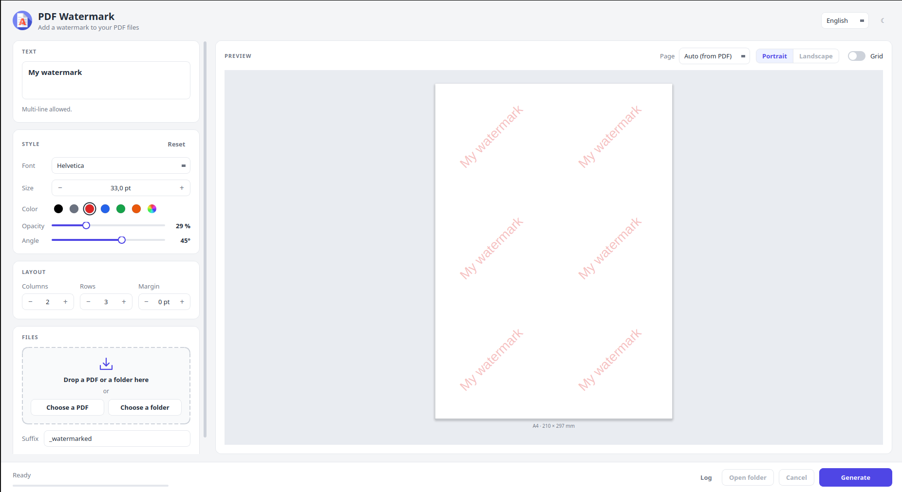

# watermark-pdf

watermark-pdf est une application de bureau (PyQt5), locale et hors ligne, pour ajouter un filigrane texte à vos fichiers PDF : un document, une sélection de documents ou un dossier entier d'un coup.

Tout s'exécute sur votre propre machine : vos documents ne sont jamais envoyés nulle part, et aucune connexion internet n'est nécessaire.



## Fonctionnalités

- **Plusieurs fichiers ou un dossier entier**, sous-dossiers inclus si vous le souhaitez.
- **Sélection de pages** : filigranez seulement certaines pages, par exemple `1;3;5-9` (une sélection par fichier, ou une pour tout le dossier). Vide = toutes les pages.
- **Aperçu en direct** identique au PDF généré, dessiné avec les mêmes contours de caractères. Choisissez le PDF et la page à prévisualiser, et affichez le contenu de la page sous le filigrane (*Afficher la source*).
- **Filigrane personnalisable** : texte multiligne, police, taille, couleur, opacité, angle, grille et marge.
- **Difficile à extraire du texte** : le filigrane est dessiné en contours vectoriels et non en texte. Il ne peut être ni sélectionné, ni copié, ni recherché, ni extrait, et il est marqué comme artefact de filigrane (ignoré par les lecteurs d'écran).
- **Polices** : 12 polices incluses (Liberation Sans, Serif et Mono, aux mêmes dimensions qu'Arial/Helvetica, Times et Courier) couvrant le latin, le grec et le cyrillique, plus n'importe quelle police TrueType/OpenType de votre ordinateur (par exemple pour le chinois ou le japonais).
- **Sortie sûre** : fichiers enregistrés à côté des originaux avec le suffixe de votre choix, écrits de façon atomique. Rien n'est généré si une destination existe déjà, sauf si *Écraser* est coché.
- **Fidèle à l'original** : signets, métadonnées, liens et champs de formulaire sont conservés ; les pages pivotées ou rognées sont gérées ; les PDF protégés (mot de passe propriétaire uniquement) gardent leur chiffrement et leurs permissions.
- **Glisser-déposer**, barre de progression, annulation et journal.
- **Thème clair/sombre** et **5 langues** (anglais, français, espagnol, italien, allemand).

## Installation

### Exécutables prêts à l'emploi (recommandé)

Téléchargez la dernière version pour votre système depuis la [page Releases](https://github.com/Artezaru/watermark-pdf/releases) :

- **Windows** : téléchargez et lancez directement `watermark-pdf-windows.exe`, aucune installation nécessaire.
- **Linux (Debian/Ubuntu)** : téléchargez le paquet `.deb` et installez-le avec :
  ```bash
  sudo dpkg -i watermark-pdf_*.deb
  ```
  watermark-pdf apparaît alors dans le menu des applications sous le nom *PDF Watermark*, ou peut être lancé depuis un terminal avec `watermark-pdf`.

Les exécutables incluent toutes les fonctionnalités optionnelles.

### Depuis les sources (développeurs)

Nécessite Python 3.11 ou plus récent.

```bash
git clone https://github.com/Artezaru/watermark-pdf.git
cd watermark-pdf
pip install ".[preview]"
```

Dépendances optionnelles :

| Option | Paquet | Apporte |
|---|---|---|
| `preview` | [pypdfium2](https://github.com/pypdfium2-team/pypdfium2) | *Afficher la source* dans l'aperçu (contenu des pages du PDF) |
| `progress` | [tqdm](https://github.com/tqdm/tqdm) | barres de progression dans la console (usage en bibliothèque uniquement) |
| `all` | les deux | |

Sans `preview`, l'application fonctionne normalement : seule l'option *Afficher la source* est désactivée.

Lancez-le avec :

```bash
watermark-pdf
```

ou :

```bash
python -m watermark_pdf
```

## Utilisation comme bibliothèque Python

Le moteur de filigrane peut aussi être utilisé sans l'interface :

```python
from watermark_pdf.watermark import (
    add_watermark, batch_watermark_directory, watermark_files, register_font,
)

# Un fichier -> rapport_watermarked.pdf
add_watermark(
    "rapport.pdf",
    "CONFIDENTIEL\nNe pas diffuser",
    pages=[0, -1],              # première et dernière pages (indices à partir de 0) ; None = toutes
    horizontal_boxes=3,
    vertical_boxes=6,
    opacity=0.15,
    angle=45,
    color="#DC2626",
    font="LiberationSans-Bold",
    size=24,
)

# Plusieurs fichiers, chacun avec ses pages -> à côté de chaque original
watermark_files({"a.pdf": [0], "b.pdf": None}, "CONFIDENTIEL")

# Tous les PDF d'un dossier -> documents_watermarked/
batch_watermark_directory("documents", "CONFIDENTIEL", recursive=True, overwrite=True)

# N'importe quelle police de votre ordinateur
nom = register_font("C:/Windows/Fonts/msyh.ttc")    # -> "msyh"
add_watermark("rapport.pdf", "机密", font=nom, overwrite=True)
```

Bon à savoir :

- Une sortie existante n'est jamais remplacée sans `overwrite=True` (sinon `DestinationExistsError`, levée avant toute écriture). Pour un dossier, `overwrite=True` supprime et remplace tout le dossier de sortie.
- Les pages sont des indices à partir de 0 ; les indices négatifs comptent depuis la fin ; les indices au-delà de la fin d'un PDF sont ignorés.
- `available_fonts()` liste les noms de polices utilisables ; `text_block_outline()` donne le contour exact du texte, par exemple pour dessiner votre propre aperçu.
- Installez `tqdm` (`pip install ".[progress]"`) pour afficher une barre de progression dans la console.

## Crédits

- L'icône de l'application provient de Flaticon : <a href="https://www.flaticon.com/free-icons/watermark" title="watermark icons">Watermark icons created by Magnific - Flaticon</a>.
- Les [polices Liberation](https://github.com/liberationfonts/liberation-fonts) incluses sont © Red Hat et Google, sous licence SIL Open Font License 1.1 (voir `watermark_pdf/resources/fonts/OFL.txt`).
- Le rendu des PDF dans l'aperçu utilise [PDFium](https://pdfium.googlesource.com/pdfium/) via [pypdfium2](https://github.com/pypdfium2-team/pypdfium2).

## Licence

watermark-pdf est un logiciel libre, sous licence **GNU General Public License v3.0 ou ultérieure**. Voir [LICENSE](LICENSE) pour le texte complet.

## Contribuer

Les rapports de bugs et les pull requests sont les bienvenus. Merci d'ouvrir d'abord un ticket sur le [tracker](https://github.com/Artezaru/watermark-pdf/issues) pour discuter de tout changement important.
