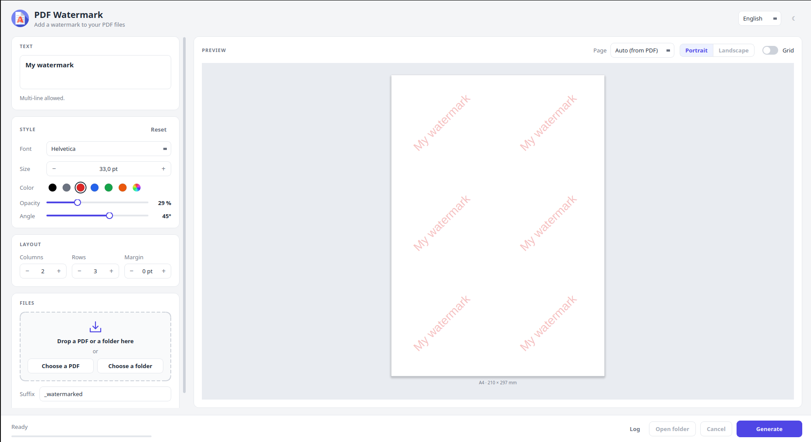

# watermark-pdf

watermark-pdf is a local, offline desktop application (PyQt5) to add a text watermark to your PDF files — one document, a selection of documents or a whole folder at once.

Everything runs on your own machine: your documents are never uploaded anywhere, and no internet connection is required.



## Features

- **Several files or a whole folder**, subfolders included if you want.
- **Page selection**: watermark only some pages, e.g. `1;3;5-9` (one selection per file, or one for the whole folder). Empty means every page.
- **Live preview** that matches the generated PDF exactly, drawn with the same glyph outlines. Choose which PDF and which page to preview, and display the content of the page under the watermark (*Show source*).
- **Customizable watermark**: multi-line text, font, size, color, opacity, angle, grid and margin.
- **Hard to strip from the text**: the watermark is drawn as vector outlines, not as text. It cannot be selected, copied, searched or extracted, and it is tagged as a watermark artifact (ignored by screen readers).
- **Fonts**: 12 bundled fonts (Liberation Sans, Serif and Mono, metric-compatible with Arial/Helvetica, Times and Courier) covering Latin, Greek and Cyrillic, plus any TrueType/OpenType font of your computer (e.g. for Chinese or Japanese).
- **Safe output**: files saved next to the originals with a suffix of your choice, written atomically. Nothing is generated if a destination already exists, unless *Overwrite* is checked.
- **Faithful to the original**: bookmarks, metadata, links and form fields are preserved; rotated and cropped pages are handled; protected PDFs (owner password only) keep their encryption and permissions.
- **Drag & drop**, progress bar, cancellation and log.
- **Light/dark theme** and **5 languages** (English, French, Spanish, Italian, German).

## Installing

### Prebuilt executables (recommended)

Download the latest release for your platform from the [Releases page](https://github.com/Artezaru/watermark-pdf/releases):

- **Windows**: download and run `watermark-pdf-windows.exe` directly, no installation needed.
- **Linux (Debian/Ubuntu)**: download the `.deb` package and install it with:
  ```bash
  sudo dpkg -i watermark-pdf_*.deb
  ```
  watermark-pdf then appears in your applications menu as *PDF Watermark*, or can be launched from a terminal with `watermark-pdf`.

The executables include every optional feature.

### From source (developers)

Requires Python 3.11 or later.

```bash
git clone https://github.com/Artezaru/watermark-pdf.git
cd watermark-pdf
pip install ".[preview]"
```

Optional dependencies:

| Extra | Package | Adds |
|---|---|---|
| `preview` | [pypdfium2](https://github.com/pypdfium2-team/pypdfium2) | *Show source* in the preview (content of the PDF pages) |
| `progress` | [tqdm](https://github.com/tqdm/tqdm) | progress bars in the console (library use only) |
| `all` | both | |

Without `preview`, the application works normally: only *Show source* is disabled.

Run it with:

```bash
watermark-pdf
```

or:

```bash
python -m watermark_pdf
```

## Using it as a Python library

The watermarking engine can also be used without the interface:

```python
from watermark_pdf.watermark import (
    add_watermark, batch_watermark_directory, watermark_files, register_font,
)

# One file -> report_watermarked.pdf
add_watermark(
    "report.pdf",
    "CONFIDENTIAL\nDo not distribute",
    pages=[0, -1],              # first and last pages (0-based); None = every page
    horizontal_boxes=3,
    vertical_boxes=6,
    opacity=0.15,
    angle=45,
    color="#DC2626",
    font="LiberationSans-Bold",
    size=24,
)

# Several files, each with its own pages -> next to each original
watermark_files({"a.pdf": [0], "b.pdf": None}, "CONFIDENTIAL")

# Every PDF of a folder -> documents_watermarked/
batch_watermark_directory("documents", "CONFIDENTIAL", recursive=True, overwrite=True)

# Any font file of your computer
name = register_font("C:/Windows/Fonts/msyh.ttc")    # -> "msyh"
add_watermark("report.pdf", "机密", font=name, overwrite=True)
```

Good to know:

- Existing outputs are never replaced unless `overwrite=True` (`DestinationExistsError` otherwise, raised before anything is written). For a folder, `overwrite=True` deletes and replaces the whole output folder.
- Pages are 0-based indices; negative indices count from the end; indices beyond the end of a PDF are ignored.
- `available_fonts()` lists the usable font names; `text_block_outline()` gives the exact outline of the text, e.g. to draw your own preview.
- Install `tqdm` (`pip install ".[progress]"`) to get a progress bar in the console.

## Credits

- The application icon is from Flaticon: <a href="https://www.flaticon.com/free-icons/watermark" title="watermark icons">Watermark icons created by Magnific - Flaticon</a>.
- The bundled [Liberation fonts](https://github.com/liberationfonts/liberation-fonts) are © Red Hat and Google, licensed under the SIL Open Font License 1.1 (see `watermark_pdf/resources/fonts/OFL.txt`).
- PDF rendering in the preview uses [PDFium](https://pdfium.googlesource.com/pdfium/) through [pypdfium2](https://github.com/pypdfium2-team/pypdfium2).

## License

watermark-pdf is free software, licensed under the **GNU General Public License v3.0 or later**. See [LICENSE](LICENSE) for the full text.

## Contributing

Bug reports and pull requests are welcome. Please open an issue on the [tracker](https://github.com/Artezaru/watermark-pdf/issues) first to discuss any significant change.
